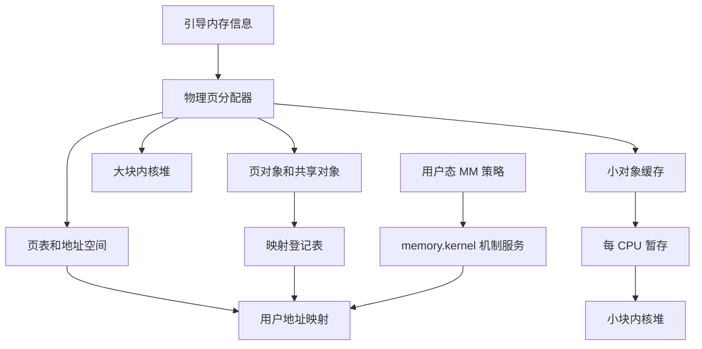

# 内核内存管理：从启动到缺页处理

本文按当前代码解释 `src/kernel/memory/` 的全部函数，包括内部辅助函数，以及 `include/kernel/page.h`、`include/kernel/mm.h` 中相关的内联函数。主要流程单独展开；只读取字段的小函数集中列出。其他模块的被调用函数只说明作用，不展开其实现。

代码主要位于 `mm` 命名空间；缺页入口是 `cpu::handlePageFault`，服务入口是 `task::memoryKernelService`，锁页区间记录属于 `task::AddressSpace::Residency`。`memset/memcpy/memmove` 使用 C 链接名。

## 1. 先掌握几个概念

可以把物理内存理解为真实仓库，把虚拟地址理解为每个进程自己使用的货架编号。页表负责记录“这个货架编号对应仓库的哪个位置”。两个进程使用同一个虚拟地址，可能访问不同物理内存；两个不同虚拟地址也可以指向同一份物理内存。

| 术语 | 通俗解释 | 本项目中的含义 |
| --- | --- | --- |
| 页、物理页框 | 固定大小的一格内存 | 普通页为 4096 字节，即 4 KiB |
| 页编号 | 第几格物理内存 | 物理地址除以 4096；页首物理地址等于页编号乘以 4096 |
| `order`，阶数 | 一次分配多少格 | 块大小为 `4096 × 2^order` 字节；0、1、2 阶分别为 1、2、4 页 |
| 元数据 | 管理内存所需的账本 | `PageFrame` 记录每个物理页的状态、块头、节点等 |
| 页表根 `root` | 一套地址翻译表的入口 | 参数通常是顶层页表的物理地址，不能传普通指针 |
| PTE | 页表中的一条记录 | 记录物理地址、存在位、读写执行权限等 |
| TLB | CPU 缓存的地址翻译结果 | 页表修改后，旧缓存可能仍在，需要主动失效 |
| TLB shootdown | 通知其他 CPU 丢弃旧翻译 | 完成后才能安全复用被解除映射的物理内存 |
| backing，后备内存 | 虚拟地址背后真正存数据的内存 | 可以来自普通物理页、页对象或共享对象 |
| 引用计数 | 还有几份使用关系 | 减到零才允许释放资源，不等于变量或指针的数量 |
| owner，所有者 | 内存归谁记账 | 通常为任务 ID，0 表示尚未归属任务等内核用途 |
| NUMA 节点 | CPU 访问不同内存的远近分组 | 优先从当前 CPU 所在节点取页，允许时再找其他节点 |
| slab | 把一页切成多个等大对象槽 | 用来高效分配小对象，减少每个小对象独占一页的浪费 |
| COW，写时复制 | 先共享，真正写入时再复制 | 先取消写权限，让后续写访问进入缺页处理 |
| VMA | 进程的一段虚拟地址使用计划 | 例如这一段来自某个文件、允许读写；主要由用户态 MM 管理 |
| 区间 `[a, b)` | 包含起点，不包含终点 | 长度为 `b-a`，相邻区间可以刚好衔接 |

“分配物理内存”和“建立映射”是两件事：前者取得仓库空间，后者建立访问路线。解除路线也不一定立即释放仓库，尤其是还有其他使用者时。

### 1.1 地址和权限约定

| 项目 | 值或规则 |
| --- | --- |
| 物理内存管理上限 | 前 64 GiB |
| 用户映射机制的地址范围 | `[0x10000, 0x0000800000000000)` |
| 物理内存直接映射基址 | `0xffff800000000000`，加物理地址即可得到对应内核访问地址 |
| 内核堆固定别名基址 | `0xffff804000000000`，与直接映射使用不同区域 |
| 范围映射的 `protection` | 位 0 表示允许写，位 1 表示允许执行；0 是只读且不可执行，1 是可写且不可执行，2 是只读可执行 |
| 写和执行 | 用户映射机制拒绝同时允许写和执行 |
| 参数单位 | `address/size/offset` 通常是字节；`first/count` 在 buddy 接口中是页编号和页数；以各函数说明为准 |

常见页表标志：`pagePresent` 表示存在，`pageWritable` 表示可写，`pageUser` 表示用户可访问，`pageNoExecute` 表示不可执行，`pageGlobal` 表示全局映射。`pageWriteThrough/pageCacheDisable` 控制缓存方式，设备映射尤其需要注意。

`pageExternal` 是软件标记，表示“这个页表项借用其他对象的页面，不独立拥有它”；`pageLocked` 表示锁页约定，不等于线程互斥锁，也不改变读写权限。accessed/dirty 是硬件记录的“访问过/写过”状态。

### 1.2 返回值不要混用

- `bool` 通常以 `true` 表示成功；输出引用参数接收查询结果。
- 指针通常以 `nullptr` 表示失败，物理地址和句柄通常以 0 表示失败。
- `mapUserPages`、`MemoryService::map/unmap/protect` 等使用 `uint64_t` 承载地址或转换后的负错误码；判断错误时应按协议解释成有符号结果。
- `SharedMemory::map` 失败返回 0；不能把它与上述错误码接口混用。
- `lockUserPages/lockAllUserPages` 返回 0 表示成功，22 表示参数错误，12 表示资源不足或页面条件不满足。
- `MemoryService::call` 的返回值表示请求处理是否成功；业务结果还可能位于 `reply.data`，新句柄位于 `reply.handles`。

## 2. 文件分工和整体依赖

所有实现路径均相对于 `src/kernel/memory/`。

| 文件 | 负责什么 |
| --- | --- |
| `physical/physical.cc` | 启动时筛选物理页，提供统一物理分配入口 |
| `physical/buddy.cc` | 连续页块的拆分、合并、引用和所有者检查 |
| `physical/topology.cc` | 从固件读取 NUMA 节点信息 |
| `heap.cc` | 按字节申请和释放内核堆内存 |
| `object/slab.cc` | 在页面中分配固定大小的小对象 |
| `object/per_cpu.cc` | 每 CPU 暂存少量对象，减少公共锁竞争 |
| `object/pool.cc` | 在调用者给定的固定存储中分配槽位 |
| `object/mapping.cc` | 内核堆别名、指针换算、物理内存清零 |
| `object/page_object.cc` | 用引用计数包装连续物理块 |
| `virtual/virtual.cc` | 页表操作、地址翻译、锁页、地址空间复制和销毁 |
| `virtual/page_mappings.cc` | 登记页对象映射，管理映射引用和权限上限 |
| `virtual/operations.cc` | 面向任务的匿名映射、解除映射和修改权限 |
| `virtual/locked.cc` | 锁页区间的查询、合并和拆分 |
| `shared/shared.cc` | 命名共享内存、类型化页池、句柄和映射记录 |
| `service/mapping.cc` | 授权后按不同后备来源分派映射操作 |
| `service/service.cc` | 接收并分派 `memory.kernel` 请求 |
| `service/pager.cc` | 内核与用户态 MM 之间的通信 |
| `fault.cc` | 缺页异常处理 |
| `memory.S` | 内核使用的基础内存填充和复制函数 |



`memory.kernel` 在内核中执行机制操作；用户态 `mm` 进程决定地址区域、文件来源、何时补页等策略。两者通过请求协作。

## 3. 启动初始化：initPhy → initVir → initHeap

`kernelMain` 依次调用这三个函数。物理页分配器必须先可用，后续才能申请页表和堆所需的页面。

### 3.1 initPhy / PhyAlloc::init：先建立可分配页集合

`initPhy(boot)` 取得全局 `phyAlloc()`，再调用 `PhyAlloc::init(boot)`。`boot` 是引导阶段收集的内存表、模块、帧缓冲、页表根等信息。

当前 `PhyAlloc` 私有继承 `BuddyAlloc`：前者负责“哪些页可以使用”，后者负责“可用页如何拆分和归还”。`using` 公开所需的引用、查询和归属接口，基类启动接口仍由内部控制。

执行步骤：

1. **位图全部清零。** 每一位代表一个物理页，0 表示不可交给分配器。前 64 GiB 一共有 `2^24` 个 4 KiB 页，位图占 2 MiB。它是静态成员存储，不从堆申请。
2. **初始化 NUMA 拓扑。** 读取 SRAT，先确定各段物理内存属于哪个节点。
3. **第一遍读内存表，开放可用 RAM。** 只接受 `memoryAvailable` 描述，并裁剪到 64 GiB 上限；把完整落入区间的页置为 1。
4. **更新最高地址。** `highestAddress` 取被接受的可用描述的最高结束地址。它是地址跨度，包含其中的空洞，不是可分配字节总和。
5. **第二遍排除保留区。** 所有非 `memoryAvailable` 描述都清零。这样即使固件条目重叠，保留描述也始终优先，与条目顺序无关。
6. **排除实际占用。** 再排除低端 1 MiB、`bootstrapStart` 到 `bootstrapEnd` 的内核和启动布局、Multiboot 信息、所有模块和帧缓冲。帧缓冲长度用 `pitch × height` 计算，包含行尾填充。
7. **计算管理数组大小。** `count = highestAddress / 4096`；每个页编号都需要一条 `PageFrame`，包括保留页和空洞。所需元数据页数为 `ceil(count × sizeof(PageFrame) / 4096)`。
8. **寻找连续元数据空间。** 从页编号 256，即 1 MiB 开始扫描。可用则连续计数加一，遇到保留页就清零；找到第一段足够长的区域后记录起点。总空闲量足够但没有足够长的连续区间，也会失败。
9. **失败则停止。** 找不到元数据存储，或所需页数为零，输出 `insufficient page metadata storage`，调用 `cpu::halt()`。
10. **先保留账本自身。** 将元数据所在页从位图清除。否则分配器将来可能把自己的账本交给调用者覆盖。
11. **初始化 buddy。** 用 `directMap + metadata × 4096` 访问管理数组，调用 `BuddyAlloc::init`。启动汇编已建立前 64 GiB 的直接映射，所以这一步不依赖后面的 `initVir`。
12. **把可用页交给 buddy。** 再扫描位图，把“连续、全部可用、同一 NUMA 节点”的页归为一段，调用 `addRange(first, count, node)`。保留页和节点变化都会截断区间。
13. **输出结果。** 打印空闲页数和节点数，物理页分配接口开始可用。

`range(first, size, usable)` 是上述筛选的关键：开放时向内取整，只接受完整页；保留时向外取整，只要碰到某页就保留整页。例如 `[0x1800, 0x3800)` 开放时只开放 `[0x2000, 0x3000)`，保留时则覆盖 `[0x1000, 0x4000)`。

整个过程用“静态位图 → 预留管理数组 → 正式分配器”解决自举问题，没有用尚不存在的堆来创建物理分配器。

### 3.2 initVir：接管启动页表

1. 检查 `boot` 和启动页表根，缺失则输出错误并停机。
2. 保存根物理地址到 `kernelAddressSpaceRoot`。
3. 清除顶层页表第 0 项，移除启动时的低地址恒等映射。
4. 重新加载 CR3，让 CPU 使用更新后的页表。
5. 保留高半区直接映射，后续以高地址访问物理内存。

它接管已经建立的页表，而不是从完全没有分页的状态开始建立分页。

### 3.3 initHeap：准备大小档位

初始化 32、64、128、256、512、1024、2048 字节七档缓存，各档包含自己的管理头。此时只是准备缓存状态，slab 物理页在真正申请时按需取得。

随后 `cpu::init()` 建立 CPU 局部数据，再调用 `memoryTopology().enableCpuLocal()` 和 `enableCpuObjectCaches()`。此前节点选择和 CPU 暂存索引使用启动默认值 0。

## 4. 物理页与 NUMA：完整函数表

### 4.1 PhyAlloc 和统一入口

位置：`physical/physical.cc`、`page.h`。

| 函数 | 输入、作用和结果 |
| --- | --- |
| `phyAlloc()` | 返回全局物理分配器的引用，整个内核共用同一套页状态 |
| `initPhy(boot)` | 启动入口，转交 `PhyAlloc::init`，流程见第 3 节 |
| `PhyAlloc::init(boot)` | 筛选页、保留管理数组、初始化 buddy 并加入空闲区间 |
| `PhyAlloc::test(page)` | 输入页编号，返回启动位图中对应位是否为 1 |
| `PhyAlloc::set(page, usable)` | 设置一个启动位；不维护 buddy 空闲计数 |
| `PhyAlloc::range(first, size, usable)` | 输入物理字节范围，裁剪上限并按开放/保留规则取整，逐页设置位图 |
| `PhyAlloc::allocate(order, owner, node, strict, maximum)` | 将未指定节点换成当前 CPU 节点，再调用 `BuddyAlloc::allocate`；返回物理块首地址，失败为 0 |
| `PhyAlloc::retain/release/assignOwner/query` | 通过 `using` 公开的基类方法，语义见下一表 |
| `PhyAlloc::ownedBytes(owner)` | 所有者占用页数乘以 4096，返回字节数 |
| `PhyAlloc::totalBytes()` | 返回最高管理地址跨度，包含空洞 |
| `PhyAlloc::freeBytes()` | buddy 当前空闲页数乘以 4096 |
| `allocatePhysicalBlock(order, owner, node, strict, maximum)` | 统一块分配入口；默认 owner 为 0、节点自动选择、允许回退、无额外地址限制 |
| `allocatePhysicalPage()` | 相当于申请 0 阶块，即一页；不会自动清零 |
| `freePhysicalPage(address)` | 归还一页的一份引用；实际执行 0 阶释放并跳过 owner 匹配，返回是否通过检查 |
| `retainPhysicalBlock(address, owner)` | 增加指定物理块引用，返回是否成功 |
| `releasePhysicalBlock(address, order, owner)` | 按原始阶数归还一份引用，引用为零才真正释放 |
| `assignPhysicalPageOwner(address, owner)` | 给未归属块登记所有者，或确认现有归属 |
| `queryPhysicalPage(address, info)` | 查询地址所属块，将状态写入 `PhysicalPageInfo`；可输入块内地址 |
| `getOwnedMemoryBytes(owner)` | 返回按 owner 记账的已分配物理字节数 |
| `getTotalMemoryBytes()` | 返回管理地址跨度，不能当作可用 RAM 总和 |
| `getFreeMemoryBytes()` | 返回当前空闲物理字节数 |

### 4.2 BuddyAlloc

位置：`physical/buddy.cc`。空闲链表按 `heads_[node][order]` 组织，链中只存块头的页编号。`noFrame` 表示没有块头；物理地址 0 不作为成功分配结果。

| 函数 | 输入、作用和结果 |
| --- | --- |
| `init(frames, count)` | 接收已准备好的元数据数组；清空链头和空闲数、初始化锁、原地构造各记录，所有页先为 `Reserved` |
| `mark(head, order, node, state)` | 重写整个块的记录：内部页为 `Interior` 并指向块头，块头记录阶数和指定状态 |
| `insert(head)` | 将空闲块头插入所属节点、所属阶数的双向链表 |
| `remove(head)` | 从空闲链摘除块头，修正前后链接 |
| `addRange(first, count, node)` | 输入页编号、页数、节点；确认全段仍为保留状态后，拆成对齐二次幂块入链；失败返回 false |
| `allocate(order, owner, preferred, strict, limit)` | 按节点和阶数找块，必要时拆分；`limit` 是请求块结束物理地址的上限；返回首地址或 0 |
| `retain(address, owner)` | 仅接受已分配块头，核对 owner 和引用上限后加一；失败 false |
| `release(address, order, owner)` | 校验块头、阶数、owner；减引用，归零后尝试伙伴合并；失败 false |
| `assignOwner(address, owner)` | 只接受已分配块头；允许从 owner=0 设置归属，或保持同一 owner，拒绝直接抢走其他 owner 的块 |
| `query(address, info)` | 从块内地址找到块头并返回块状态，不增加引用 |
| `pagesOwned(owner)` | 扫描已分配块头，按 `2^order` 累计页数，不重复计算内部页 |
| `freePages()` | 在锁内读取当前空闲页数 |

`retain/release` 中 `owner=UINT64_MAX` 表示可信内核调用可跳过 owner 匹配，块状态、阶数等检查仍然有效。`mark/insert/remove` 是内部函数，由初始化阶段或已持锁的路径调用。

### 4.3 伙伴分配和释放流程

`addRange` 每次选“地址满足对齐、长度不超过剩余范围”的最大块。例如页编号 `[256,269)` 共 13 页，会拆为 8 页、4 页、1 页三块。

`allocate` 的执行顺序：

1. 检查分配器已初始化、阶数和节点合法。
2. 持锁，优先找指定节点；严格模式不换节点，普通模式按节点编号顺序回退。
3. 从请求阶数向上搜索，遍历空闲链，跳过超过物理地址上限的候选。
4. 摘下找到的块。若块太大，反复对半拆开，继续使用低地址半块，将高地址半块放回对应空闲链。
5. 将最终块标为 `Allocated`，记录 owner，初始引用设为 1。
6. 空闲页数只减去实际交出的页数，返回物理地址。

例如申请一页却只找到四页块，就先拆成两个两页块，再把低半块拆成两页单页块，最后交出其中一页。

`release` 的执行顺序：

1. 核对输入是合法已分配块头，阶数与最初分配一致，owner 符合要求。
2. 引用减一。仍大于零时成功返回，物理内存继续保留。
3. 引用为零时恢复空闲计数，用 `head XOR (1 << order)` 找到同阶伙伴。
4. 伙伴必须在范围内、处于 `Free`、阶数相同且属于同一节点，才能摘链合并。
5. 合并使用更低页编号作为新块头，阶数加一，继续向上尝试。
6. 最后统一重写整个块的记录并入链。

所以两个相邻空闲区域不一定能合并：还必须满足伙伴对齐、同阶数、同节点等条件。

### 4.4 NUMA 拓扑函数

位置：`physical/topology.cc`、`mm.h`。

| 函数 | 输入、作用和结果 |
| --- | --- |
| `readSratValue(data, bytes)` | 按小端顺序逐字节拼成整数，避免未对齐读取 |
| `memoryTopology()` | 返回全局拓扑对象 |
| `MemoryTopology::init(boot)` | 找到 ACPI SRAT，按条目长度遍历；读取启用的内存、旧 APIC、x2APIC 亲和信息；缺表时保留默认节点 0 |
| `nodeForDomain(domain)` | 将固件域编号转换为紧凑节点编号；新域占一个槽，满时返回 `anyMemoryNode` |
| `nodeForAddress(address)` | 查物理地址所属区间，未找到返回节点 0 |
| `enableCpuLocal()` | 表示 CPU 局部数据已就绪，允许查询真实当前 CPU |
| `currentNode()` | 未就绪返回 0；就绪后根据当前 APIC ID 查询节点，未匹配也返回 0 |
| `nodeCount()` | 返回已建立的节点数 |
| `Range()`、`Range(start, stop, domain)` | 默认构造区间，或保存起止地址和节点 |
| `Range::contains(address)` | 判断地址是否属于左闭右开区间 |
| `Cpu()`、`Cpu(id, domain)` | 默认构造 CPU 记录，或保存 APIC ID 与节点 |
| `Cpu::matches(id)` | 比较记录的 APIC ID |

当前最多记录 16 个节点、64 段内存亲和区间、256 个 CPU 亲和记录。分配回退按节点编号进行，没有根据 SLIT 距离排序。

### 4.5 页状态内联函数

`FrameState` 的四种状态：`Reserved` 为不可分配页，`Free` 为独立空闲块头，`Allocated` 为已分配块头，`Interior` 为块内部页。内部页通过 `head` 找到整块信息。

| 函数 | 作用 |
| --- | --- |
| `PageFrame::reset()` | 恢复默认管理记录，不清零物理页内容 |
| `PhysicalPageInfo()` | 默认构造查询结果 |
| `PhysicalPageInfo(owner, references, node, order, state)` | 用指定字段构造查询结果 |
| `getOwner()/getReferences()/getNode()/getOrder()/getState()` | 分别读取所有者、物理块引用数、节点、阶数、状态 |

## 5. 内核堆和对象缓存

### 5.1 allocateHeap / freeHeap 的执行流程

`allocateHeap(size)`：

1. 拒绝零长度和过大申请，保证加管理头不会溢出。
2. 计算 `required = size + sizeof(Header)`，管理头为 16 字节。
3. 从七个大小档位中选能容纳 required 的最小档。例如申请 40 字节，合计 56 字节，选择 64 字节档。
4. 小对象先从当前 CPU 暂存取；没有时进入公共 slab 缓存；公共缓存也满了才申请新物理页。
5. 超过 2048 字节档时，计算足以容纳 required 的最小阶数，申请连续物理块，再建立可写、不可执行的堆别名。别名失败则归还刚申请的物理块。
6. 在 Header 记录分配标记、档位或阶数，返回 Header 后的数据地址。

返回区域保持 16 字节对齐，但不自动清零，也不自动调用 C++ 构造函数。

`freeHeap(object)`：

1. 空指针直接忽略，不满足 16 字节对齐则返回。
2. 向前退一个 Header，换算堆别名对应的物理地址。
3. 查询底层物理块，要求仍为已分配状态且 owner=0。
4. 用原子比较交换把“已分配”标记改成“已释放”，只有成功认领这次释放的线程才能继续。
5. 小块退回当前 CPU 暂存；暂存满时交回公共 slab。
6. 大块还要核对页首对齐和原始阶数，再归还物理块。

这些检查用于发现常见错误，不代表可以传任意地址，也不能保证识别地址被重新分配后的所有悬空指针。调用者应传原分配结果并负责对象析构。

### 5.2 ObjectCache 的页内分配流程

一页布局为“Slab 管理头 + 若干等间距对象槽”。未使用的槽用自己的前几个字节保存下一个空槽地址；槽被分配后，这些字节就归调用者使用。

`allocate()` 先找有空槽的 slab，没有则申请并映射一页，初始化管理头、占用位图和空槽链；随后弹出一个槽，置占用位，增加活对象数。失败返回 nullptr。

`release(object)` 向下按 4 KiB 对齐找到管理头，核对所属缓存、精确槽边界和占用位，再清位、把槽压回空闲链。某页变空时，默认保留一页供复用，多余全空页立即归还。

CPU 暂存中的对象仍被 slab 视为活对象。因此“调用者已经 free”不一定等于“物理页已经空闲”。主动回收必须先清 CPU 暂存，再回收全空 slab。

### 5.3 堆与缓存完整函数表

| 函数 | 输入、作用和结果 |
| --- | --- |
| `initHeap()` | 初始化七个大小档位，见第 3 节 |
| `allocateHeap(size)` | 按字节申请，返回数据指针或 nullptr |
| `freeHeap(object)` | 读取前置管理头，按来源归还，不返回结果 |
| `reclaimCaches()` | 对七档依次 drain，返回汇总得到的回收字节数 |
| `ObjectCache::init(objectSize)` | 接受 1～2048 字节对象，将槽间距向上对齐到 16 字节；初始化锁和空链 |
| `ObjectCache::allocate()` | 返回一个槽地址，没有资源时 nullptr |
| `ObjectCache::release(object)` | 归还精确槽地址，重复释放或来源不符返回 false |
| `ObjectCache::unlink(slab)` | 只从缓存双向链摘页，不单独决定释放时机 |
| `ObjectCache::shrink()` | 释放当前全空 slab，返回页数；注意不是字节数 |
| `ObjectCache::Slab::hasSpace()` | 根据空槽链头判断是否有空位 |
| `enableCpuObjectCaches()` | CPU 局部数据可用后启用真实 CPU 索引 |
| `PerCpuObjectCache::currentCpu()` | 未启用时 0，启用后用当前 CPU ID 对 64 取模 |
| `PerCpuObjectCache::init(objectSize)` | 初始化公共缓存和 64 个 CPU 暂存区，每区最多 8 个对象 |
| `PerCpuObjectCache::allocate()` | 短暂关中断并取当前 CPU 暂存；没有则放锁后从公共缓存申请 |
| `PerCpuObjectCache::release(object)` | 空指针忽略；当前 CPU 暂存未满则入栈，否则放锁后退回公共缓存 |
| `PerCpuObjectCache::drain()` | 逐个清空 CPU 暂存并调用 shrink，返回最终 shrink 的页数 |
| `PerCpuObjectCache::Magazine::take()` | 弹出暂存区最后一个对象，空时 nullptr；锁由调用方保证 |

`drain` 过程中归还对象也可能触发 slab 即时释放；它的返回计数来自最后的 `shrink()`，因此不要将返回值当作并发情况下所有物理释放事件的精确审计值。

### 5.4 FixedPool：固定容量的对象池

`FixedPool` 不申请新 backing。调用者先提供一块存储，它负责将存储切成等大槽位，最多 4096 槽，耗尽直接失败。

| 函数 | 输入、作用和结果 |
| --- | --- |
| `init(storage, bytes, objectSize)` | 检查存储 16 字节对齐和容量，把槽大小向上对齐，清位图并建立空闲索引链；成功 true |
| `allocate()` | 弹出空闲索引、置位、减少空闲数，返回槽地址；耗尽 nullptr |
| `release(object)` | 核对精确槽首和占用位，清位并压回空闲链；无效或重复释放 false |
| `available()` | 返回剩余槽数，不是剩余字节数 |

它与 slab 的区别是容量固定、存储由外部提供；例如 `Maps` 用它管理预置的映射记录数组。

### 5.5 内核访问地址与基础复制函数

| 函数 | 输入、作用和结果 |
| --- | --- |
| `mapKernelPages(physical, order)` | 为整个块逐页检查/建立 `heapBase + physical` 的可写 NX 别名；已指向同一页则复用，冲突或建表失败返回 nullptr |
| `clearPhysicalPages(physical, bytes)` | 通过直接映射逐字节清零；参数是调用者已保证可写的物理范围 |
| `physicalFromKernelPointer(address)` | 仅接受堆固定别名区域，减去 heapBase 得物理地址；范围外返回 0，不检查实际 PTE 是否存在 |
| `memset(destination, value, size)` | 将低 8 位字节值重复写入目标，返回原目标地址 |
| `memcpy(destination, source, size)` | 向前复制，返回原目标；源目标不能重叠 |
| `memmove(destination, source, size)` | 根据地址关系选择正向或倒向复制，允许重叠，返回原目标 |

`mapKernelPages` 不接管物理块所有权，失败可能留下本次已建立的固定别名；调用者仍要归还自己申请的块。`memmove` 倒向复制使用方向标志 DF，返回前恢复为正向；正向字符串指令依赖调用约定中的 DF=0。

## 6. PageObject：让页面跟随使用关系存活

直接分配的物理地址只是一串数字，不能自动表达“句柄和映射都还在使用这块内存”。`PageObject` 给连续物理块加了一层引用计数包装。

| 函数 | 输入、作用和结果 |
| --- | --- |
| `PageObject(order, owner, node)` | 最多接受 12 阶，申请连续物理块并清零；申请失败仍构造出包装，但 valid 为 false |
| `~PageObject()` | 私有析构，归还最后一份物理块引用 |
| `valid()` | 物理地址非 0 即为有效 |
| `retain()` | 增加物理块引用和对象引用，供新映射等长期使用关系持有 |
| `release()` | 对象引用减一；非最后引用归还对应物理引用，最后引用负责析构并 freeHeap 包装 |
| `size()` | 有效时返回 `4096 << order` 字节，否则 0 |
| `physical()/owner()/order()` | 读取物理首地址、owner 和阶数 |
| `references()` | 原子读取对象引用计数 |
| 复制构造、复制赋值 | 已删除，禁止按值复制产生两份互不协调的管理对象 |

典型流程：申请包装 → 构造并检查 valid → 安装句柄 → 建立映射时 retain → 关闭句柄时 release → 最后映射消失时 release → 物理块和包装都被归还。

最后一次 release 不额外归还两次物理引用：最后那一份由析构函数处理。

## 7. 页表：单页映射、翻译和跨空间复制

### 7.1 四级页表如何定位一页

每张页表一页，包含 512 个 64 位表项。普通 4 KiB 页的虚拟地址拆成：

```text
高位          39       30       21       12        0
              | PML4 | PDPT  | PD    | PT    | 页内偏移 |
                 9位     9位     9位     9位      12位
```

`mapPageInAddressSpace(root, virtual, physical, flags)` 的流程：

1. 检查两个地址都按 4 KiB 对齐。
2. 取得全局页表锁，调用 `mapPageLocked`。
3. 从虚拟地址取出四级索引，查询根页 owner。
4. 沿各级查找，缺少中间页表时分配并清零，再写入父表。用户位需要沿上层传播。
5. 遇到 1 GiB 大页路径拒绝；遇到 2 MiB 大页可先拆成 512 个 4 KiB 映射。
6. 若目标叶子已存在则拒绝覆盖；否则写入物理地址、权限和存在位。
7. 对非 external 用户页，按根 owner 记账。
8. 本地执行 `invlpg`，释放锁并返回结果。

注意：拆大页保留原映射关系，并不自动将目标叶子变空；已有映射仍不会被新映射覆盖。建表失败也可能留下已经准备好的中间表，由地址空间后续统一清理。

### 7.2 页表内部辅助函数

位置：`virtual/virtual.cc`。名字带 `Locked` 表示调用者应已持有页表锁。

| 函数 | 输入、作用和结果 |
| --- | --- |
| `getTable(address)` | 从物理地址或表项去掉标志，添加直接映射基址，返回页表指针 |
| `getTablePhysicalAddress(table)` | 将直接映射中的页表指针减去基址，还原物理地址 |
| `allocateTable()` | 申请物理页并清零 512 项，返回表指针或 nullptr |
| `getOrCreateTable(parent, index, flags, owner)` | 缺失时创建下级表并登记 owner，根据 flags 传播用户位，返回下级表 |
| `splitLargePage(directory, index)` | 将 2 MiB 叶子展开为 512 个 4 KiB 叶子，先准备完整新表再替换父项；失败 nullptr |
| `mapPageLocked(root, virtual, physical, flags)` | 安装一个不存在的叶子，创建必要中间表；成功 true |
| `unmapPageLocked(root, virtual)` | 查找并清除已有普通页叶子，不释放后备页、不新建表 |
| `protectPageLocked(root, virtual, flags)` | 修改普通页权限，保留物理地址、external、locked、accessed/dirty |
| `translateLocked(root, virtual, flags)` | 逐级翻译，支持 1 GiB、2 MiB、4 KiB 叶子；返回包含页内偏移的物理字节地址，失败 0，可输出叶子标志 |
| `editPages(root, address, size, flags, protect)` | 一次最多 64 页；先校验整批，再统一解除或改权限，最后进行批量 TLB 失效 |
| `releaseUserPageTables(table, level)` | 递归释放私有用户页表，普通叶子归还物理页，external 叶子跳过 |
| `findDumpPage(table, level, base, cursor, address, flags)` | 递归找游标后的驻留用户小页；跳过大页和设备缓存映射，找到返回 true |

### 7.3 页表对外函数

| 函数 | 输入、作用和结果 |
| --- | --- |
| `initVir(boot)` | 接管启动页表并移除低地址恒等映射，见第 3 节 |
| `mapPage(virtual, physical, flags)` | 使用内核根调用单页映射 |
| `mapPageInAddressSpace(root, virtual, physical, flags)` | 在指定根中映射一页，成功 true |
| `unmapPage(virtual)` | 在内核根中解除一页映射 |
| `unmapPageInAddressSpace(root, virtual)` | 清 PTE，失效本地和远端旧翻译；不释放物理页 |
| `protectPageInAddressSpace(root, virtual, flags)` | 修改一页用户权限，并使相关 CPU 旧翻译失效 |
| `unmapPagesInAddressSpace(root, address, size)` | 调用 editPages 批量解除，一次最多 64 页，不管理对象引用 |
| `protectPagesInAddressSpace(root, address, size, flags)` | 调用 editPages 批量改用户权限，一次最多 64 页 |
| `getPhysicalAddress(virtual)` | 在内核根查询物理地址，并非查询当前进程根 |
| `getPhysicalAddressInAddressSpace(root, virtual, flags)` | 持页表锁翻译指定根，可输出叶子标志 |
| `validateUserMemory(root, address, size, writable)` | 检查整个范围每页存在且用户可访问，需要时检查可写；零长度成功，不主动补页 |
| `allocateUserPageInAddressSpace(root, address, flags)` | 申请并清零一页，再尝试映射；失败归还新页，返回 `UserPageMapResult` |
| `copyToAddressSpace(root, destination, source, size)` | 从内核源缓冲向目标根写入，逐页翻译后经直接映射复制 |
| `copyFromAddressSpace(destination, root, source, size)` | 从指定根读取到内核缓冲，逐页翻译复制 |
| `nextDumpPage(root, cursor, address, flags)` | 持页表锁枚举下一页可转储用户小页；不触发缺页 |
| `getKernelAddressSpaceRoot()` | 返回内核页表根物理地址 |
| `createAddressSpaceRoot()` | 新建根，低半区清空，高半区复制内核公共根项，返回物理地址或 0 |
| `cloneAddressSpaceRoot(source, destination)` | 将用户普通页深拷贝到已有目标根，external 页仅复制映射；失败 false |
| `destroyAddressSpaceRoot(root)` | 释放用户低半区和根，拒绝零地址与内核根 |
| `switchAddressSpace(root)` | 只在当前 CPU 切换 CR3；0 表示内核根，相同根不重复切换 |

`UserPageMapResult` 区分 `Success/InvalidArgument/OutOfMemory/MappingFailed`。`allocateUserPageInAddressSpace` 的底层地址下限为 4096，范围映射接口的下限为 0x10000，不能把两层检查混为一谈。

`validateUserMemory` 对当前系统服务自己的高半区地址有专门例外：根必须确实属于当前系统服务，此时不要求 pageUser，但仍检查映射存在和需要的写权限。普通用户地址不能使用这个例外。

`copyTo/From` 不切换 CR3，按每页剩余长度复制，下一页重新翻译；失败前可能已复制一部分。`copyTo` 不负责替调用者实施用户写权限或 COW 策略。

## 8. 用户范围操作与页对象映射登记

硬件页表只记录“地址指向哪里”，还需要 `Maps` 记录“谁持有对象、允许哪些权限、解除时释放哪份引用”。

### 8.1 范围操作完整函数表

位置：`virtual/operations.cc`。

| 函数 | 输入、作用和结果 |
| --- | --- |
| `error(value)` | 将负系统错误码转换为 uint64_t 表示，仅供本文件使用 |
| `validUserRange(address, size)` | 检查非空、无溢出且在用户范围；页对齐由外层函数另行检查 |
| `mapUserPages(target, address, size, protection)` | 立即为匿名范围申请普通页；地址和大小需页对齐，单次最多 64 MiB；成功返回 address，失败负错误码 |
| `unmapUserPages(target, address, size, preserveLocks)` | 整段预检、预留记录、撤销映射和归还引用；成功 0；preserveLocks 保留锁页约定供内部替换页使用 |
| `protectUserPages(target, address, size, protection)` | 检查对象权限上限和全部页面后分批修改权限；成功 0，失败负错误码 |

### 8.2 匿名 mapUserPages 流程

1. 检查目标不是 idle、地址大小页对齐、非空、用户范围、64 MiB 上限和权限组合。
2. 锁定目标地址空间，确认根仍存在。
3. 复制锁页区间记录；启用 future 锁页时，先在副本中加入新区间并检查限额。
4. 转换 protection 为用户、写、NX 标志。
5. 每次申请一个物理页，安装映射，然后经直接映射将这一页清零；按锁页记录设置 pageLocked。
6. 任意一步失败，归还当前新页，再倒序撤销本次已映射的前缀，完成失效后释放对应页，不碰原有映射。
7. 全部成功才提交锁页记录，返回虚拟起点。

### 8.3 Maps 和 Map 完整函数表

位置：`virtual/page_mappings.cc`、`page.h`。记录存储有 2048 个预置 `Map` 槽，由 FixedPool 管理。

| 函数 | 输入、作用和结果 |
| --- | --- |
| `maps()` | 返回全局页对象映射登记表 |
| `Map()` | 默认构造空记录 |
| `Map(target, object, address, size, offset, protection, next)` | 保存目标任务、页对象、虚拟范围、对象偏移、权限上限和链指针 |
| `Map::overlaps(first, length)` | 判断两个左闭右开区间是否相交 |
| `Maps::init()` | 初始化锁、空链和固定记录池，返回成功与否 |
| `Maps::allocate()` | 从池取槽并原地构造空 Map，耗尽 nullptr |
| `Maps::map(target, object, address, size, offset, protection, maximumProtection)` | 校验并逐页映射页对象，成功发布记录并 retain，失败 false |
| `Maps::prepareUnmap(target, address, size, reservation)` | 如果删中段会产生左右两条记录，预留额外槽，通过 reservation 输出；不改页表 |
| `Maps::completeUnmap(target, address, size, reservation)` | PTE 撤销后删除、缩短或拆分记录；同步对象偏移、引用并归还剩余预留槽 |
| `Maps::releaseTask(target)` | 删除任务所有页对象记录并 release；不代替页表销毁 |
| `Maps::cloneTask(source, target)` | 先确认槽数充足，再复制源记录并为每条新记录 retain |
| `Maps::protectionAllowed(target, address, size, protection)` | 检查所有重叠记录，拒绝越过最大权限或给 COW 记录直接加写权限 |
| `Maps::markCopyOnWrite(target, address, size)` | 要求精确匹配记录，逐页去掉写权限并失效 TLB，成功后设置 cow |
| `Maps::nextManagedMapping(target, cursor, address, size)` | 找起点不小于 cursor 的下一段 pagerManaged 记录，供服务恢复 |
| `Maps::dumpAllowed(target, address)` | 判断地址是否属于可信内存服务建立的页对象映射，供核心转储筛选 |

`Maps::map` 的流程是：检查对象范围和权限 → 锁目标空间和登记表 → 拒绝记录重叠 → 先取记录槽 → 试算锁页 → 逐页建立 external PTE → 成功后 retain 并挂链。失败撤销本次映射前缀并退回槽，底层物理块仍归对象。

映射记录保存的 `maximumProtection` 来自原句柄权利；即使当前只读，也不能脱离原授权随意升为可写。`pagerManaged` 根据实际调用者身份记录，不接受用户自己声明。

### 8.4 unmapUserPages：为什么必须先准备再删除

例如原记录为 `[A,D)`，只删除中段 `[B,C)` 后，需要两条记录 `[A,B)` 和 `[C,D)`。如果先删页表，再发现没有第二个记录槽，账本就无法描述剩余映射。

因此顺序为：

1. 锁定目标空间，检查整个范围的每页都存在、属于用户且是普通小页。
2. 在锁页记录副本中模拟移除；内部替换页可要求保留锁页约定。
3. 先请 SharedMemory 预留拆分槽，再请 Maps 预留；后者失败则取消前者的预留，原映射保持不动。
4. 每批最多 64 页，先保存物理地址和原标志，再批量删除 PTE。
5. 等本地和远端 TLB 失效完成后，普通页归还物理分配器；external 页交给对象生命期管理，不能直接 free。
6. 提交锁页记录，再通过 `completeUnmap/releaseMapping` 更新对象记录和引用。

删除映射前缀时，页对象记录的虚拟起点和对象 offset 必须一起前移，否则剩余虚拟地址会指向错误的对象数据。

### 8.5 protectUserPages：先查权限上限，再改页表

先检查范围和写执行组合，锁目标空间；然后同时查询 SharedMemory 和 Maps 的权限限制，再预检每页存在和类型。检查通过后转换标志，每批最多 64 页更新，并完成 TLB 失效。物理地址、external、locked 和硬件访问状态由底层保留。

它修改的是已有映射权限，不负责分配缺失页面，也不能通过通用 protect 绕过 COW。

## 9. 锁页：登记哪些页应留在内存中

锁页包含两部分：页表上的 `pageLocked` 标记，以及进程中的锁页区间记录。后者能覆盖尚未实际补入的页面；将来映射这些地址时再设置对应页标记。

### 9.1 完整函数表

| 函数 | 输入、作用和结果 |
| --- | --- |
| `setPageLock(root, address, locked)` | 内部函数，找到驻留用户小页后设置或清除软件 locked 位，失败 false，不修改读写权限 |
| `lockUserPages(target, address, size, locked, allowAbsent, checkOnly)` | 对一个页对齐区间加锁或解锁；allowAbsent 允许未补页，checkOnly 只预检；返回 0/22/12 |
| `lockAllUserPages(target, flags, ranges, count)` | 位 0 锁当前范围，位 1 锁未来映射，0 解全部锁；ranges 为额外地址/长度对，返回 0/22/12 |
| `AddressSpace::Residency::contains(address)` | 判断地址是否属于任一锁页区间 |
| `AddressSpace::Residency::overlap(address, size)` | 累计与锁页记录重叠的字节数，不是区间数量 |
| `AddressSpace::Residency::set(address, size, locked)` | 在临时记录中合并或拆分区间，最多 128 段；成功整体提交，容量不足或范围溢出返回 false |
| `Residency::set` 内部 `RangeEmitter::operator()(begin, end)` | 将非空片段追加到临时表，相邻则合并，并维护累计字节数；容量满返回 false |

### 9.2 主要执行流程

`lockUserPages`：检查地址范围 → 锁目标空间 → 预检所有页，拒绝设备缓存类型和大页等不适用情况 → 在 Residency 副本中模拟修改 → 检查 `memlockLimit` → 若 checkOnly 则结束 → 修改已驻留页的软件位 → 提交区间记录。

`lockAllUserPages`：先在临时表中汇总驻留页和服务提供的额外区间，一次检查总额度；通过后才统一设置页标记并提交记录，最后单独设置 future 策略。仅 future 标志不会自动锁定当前所有页。

`Residency::set`：加锁时把重叠或相邻区间合并；解锁时保留删除范围以外的左右片段。整个新结果构造成功才替换旧表，因此记录空间不足时不会留下半份结果。

## 10. 共享内存：名字、句柄、映射各有寿命

共享对象可以被多个任务映射。同一物理页可以出现在不同虚拟地址，写入共享内容后，其他映射看到的是同一份数据。

对象必须同时满足以下条件才回收：没有名称链接、没有打开包装、没有存活映射。`unlink` 仅移除名字，close 仅结束句柄使用关系，unmap 仅解除地址映射，三者不能互相替代。

### 10.1 完整函数表

位置：`shared/shared.cc`、`mm.h`。以下无前缀的成员函数均属于 SharedMemory。

| 函数 | 输入、作用和结果 |
| --- | --- |
| `namesEqual(left, right)` | 内部比较共享名称是否相同 |
| `copyName(destination, source)` | 内部按固定名称容量复制并保证终止 |
| `sharedMemory()` | 返回全局共享对象登记表 |
| `releaseObject(object)` | 检查三种使用关系均已结束，才释放 backing 并清空对象槽；类型化分配只退池占用位 |
| `resolve(task, handle, rights)` | 按句柄类型和权利取得内部包装；失败 nullptr，不新建句柄 |
| `open(task, name, flags)` | 查找/创建对象并安装任务句柄；name=nullptr 表示匿名；返回句柄或 0 |
| `duplicateHandle(source, destination, handle, destinationHandle)` | 复制共享句柄引用，可指定目标句柄编号，返回句柄或 0 |
| `unlink(name)` | 按名称移除链接，现有句柄和映射继续有效，成功 true |
| `unlink(task, handle)` | 从固定的共享句柄找到对象并移除名称，成功 true |
| `resize(task, handle, size)` | 要求 manage 权利，调整普通对象逻辑字节数；有映射时拒绝缩小，失败 false |
| `querySize(task, handle, size)` | 查询逻辑大小，通过输出引用返回，成功 true |
| `map(task, handle, address, size, offset, protection)` | 将对象页映射到任务，校验句柄和权限；成功返回 address，失败 0 |
| `prepareUnmap(task, address, size, reservation)` | 中段删除需要新记录时先预留槽，成功 true |
| `cancelUnmap(reservation)` | 取消尚未提交的拆分预留，不删除现有映射 |
| `releaseMapping(task, address, size, reservation)` | PTE 移除后删除、裁剪或拆分共享映射记录，并维护 mappings 计数 |
| `protectionAllowed(task, address, size, protection)` | 按重叠共享记录的原句柄写权限上限决定能否改权限 |
| `releaseTaskMappings(task)` | 删除该任务所有共享 view，减少计数并检查对象能否回收 |
| `cloneTaskMappings(source, destination)` | 预检槽数后复制映射记录并增加对象 mappings，不重新分配共享页 |
| `closeHandleObject(object)` | 最后一个句柄引用结束时清理打开包装、减少 references，再尝试回收对象 |
| `nextManagedMapping(task, cursor, address, size)` | 枚举可信 MM 建立的下一段共享 view，找到 true |
| `openTyped(task, flags, policy)` | 打开类型化池描述句柄，按需建立专用池；返回正句柄或负错误码 |
| `typedInfo(task, handle, available)` | 按池策略查询可用字节，输出 available；成功 0，失败负错误码 |
| `allocateTyped(task, handle, size)` | 按源池策略分配，返回新的匿名结果句柄或负错误码，不把池句柄改成分配结果 |
| `SharedMemoryObject::isUsed()` | 查询对象槽占用位 |
| `SharedMemoryHandle::isUsed()` | 查询打开包装槽占用位 |
| `SharedMemoryMapping::isUsed()` | 查询映射记录槽占用位 |

当前上限：16 个对象、64 个打开包装、64 个映射记录、每普通对象最多 64 页、名称缓冲 64 字节。扩容不会自动突破这些边界。

### 10.2 open → resize → map 流程

`open`：检查只读/读写和名称格式，命名对象要求以 `/` 开头且不为空；匿名对象要求创建标志。随后持登记表锁查找名字，处理创建加排他冲突，必要时建立零大小对象。再分配打开包装，增加 references，按打开模式安装句柄。句柄安装失败则撤销本次包装和引用。

复制句柄共享已有的句柄 Reference，不等于重新 open 一次，因此 references 统计的是打开包装，不是每个任务表中所有句柄数字的总和。

`resize`：固定句柄并检查 manage 权限；拒绝类型化对象和超容量申请；有映射时拒绝缩小。增长时逐页申请并清零，全部成功才提交逻辑大小；失败只释放本次新增页，保留原内容和大小。允许逻辑大小不是整页，但 backing 按整页计算。

`map`：固定句柄 → 检查读写权利、对齐、用户范围和对象偏移 → 锁目标空间和共享表 → 先找空映射记录 → 试算锁页额度 → 按对象页数组逐页建立 external PTE → 成功后发布 view 并增加 mappings。中途失败只撤销本次 PTE，物理页继续归对象。

记录中的 writable 保存原句柄的写授权上限，而不只是当前 PTE 状态。因此只读句柄建立的映射不能通过 protect 变成可写。

### 10.3 部分 unmap 和释放流程

删除整段就退记录；删前缀或后缀就缩短；删中段用预留槽拆成两条 view，并增加一份映射计数。任务退出时 `releaseTaskMappings` 逐条结束 view，最后通过 releaseObject 判断整个对象是否还能被名称或其他任务使用。

普通共享页最终交回物理分配器；类型化分配页只退回专用池，不能逐页释放到通用 buddy。

### 10.4 类型化内存池流程

当前支持 `/memory/ram` 专用池。`openTyped` 第一次成功时申请 8 阶，即 256 页、1 MiB 连续物理块，后续用 `typedUsed_` 位图划分；整个池在当前实现中保留复用。

- policy=1：允许挑选分散空页，typedInfo 返回空闲页总字节数。
- policy=2：要求连续空页，typedInfo 返回最长连续空闲段字节数。

`allocateTyped` 检查大小非零、页对齐且不超过 64 页；先创建匿名结果对象，再在池中找齐全部页，找到后一次标占用、清零并登记页数组。失败关闭未发布的结果句柄。源句柄只读时结果也降为只读，避免通过分配操作提升权利。

## 11. memory.kernel：授权、分派和返回结果

用户通过 CallService 请求内存机制，Map/Unmap/Protect 没有对应的独立 syscall 8～10。拿到服务端点只代表可以发请求，不代表可以操作任意任务。

### 11.1 完整函数表

| 函数 | 输入、作用和结果 |
| --- | --- |
| `service/mapping.cc::error(value)` | 将系统错误码转换为 uint64_t；与 operations.cc 的同名静态函数分别作用于各自文件 |
| `isMemoryManager(caller)` | 同时检查 Memory 角色、Memory 能力和当前恢复实例身份 |
| `mappingAuthorized(caller, target)` | 目标为 0/自己时允许，否则要求当前 Memory 管理者 |
| `MemoryService(mappings, pager)` | 保存映射表和 PagerBridge 引用，不新建它们 |
| `MemoryService::map(address, size, flags, handle, offset, target)` | 授权并固定目标，按匿名/页对象/共享对象分派；flags 低两位是权限 |
| `MemoryService::unmap(address, size, target, preserveLocks)` | 授权后转 unmapUserPages；preserveLocks 仅当前 Memory 管理者可用 |
| `MemoryService::protect(address, size, protection, target)` | 普通请求转 protectUserPages，特殊 COW 请求仅当前 MM 可用，转 Maps::markCopyOnWrite |
| `readRequestName(request, word, name)` | 检查指定数据位置后是否有界且包含非空、终止的名称，成功 true |
| `copyRequestBytes(destination, source, size)` | 按字节复制固定结果结构，不依赖用户运行库 |
| `requestAuthorized(caller, target)` | 对查询、锁页等请求执行自己/当前 Memory 管理者授权检查 |
| `MemoryService::call(caller, request, reply)` | 校验公共消息长度，再按 MemoryOperation 检查参数、执行操作、填写回复；传输处理错误用负返回值 |
| `task::dispatchMemory(caller, request, reply)` | 内部创建静态 MemoryService 实例，将端点调用转给 call |
| `task::memoryKernelService()` | 返回绑定 dispatchMemory 的静态内核端点服务描述 |

### 11.2 map 和 call 的主要流程

`MemoryService::map` 先确认当前调用者有权操作目标，用 TaskReference 固定目标生命期，再读取 flags 的后备类型：

1. 匿名：要求 handle/offset 为 0，转 mapUserPages。
2. 页对象：固定调用者的 PageObject 句柄，检查所需读写权利，从真实句柄权利计算最大权限，再转 Maps::map。
3. 共享对象：同任务直接转 SharedMemory::map；跨任务先复制临时目标句柄，映射后关闭临时句柄，映射自己保留生命期。
4. 不认识的类型返回参数错误。

`call` 先检查公共最小长度 5 个数据字，再按请求种类补充长度、目标、角色和句柄检查。操作完成统一填写回复长度。涉及自解除映射或降为不可写时，还检查不能破坏当前同步调用的回复缓冲，否则结果将无法写回。

### 11.3 全部 MemoryOperation 分支

这些是 call 的协议分支，不是额外 C++ 函数。列出它们是为了能从用户请求一路对应到上述实现。

| 请求 | 执行内容和主要结果 |
| --- | --- |
| `Map/Unmap/Protect` | 转对应成员函数，业务结果写 reply.data[0] |
| `Open/Unlink/Resize` | 命名共享对象操作；Open 成功同时公布新句柄 |
| `SharedInfo` | 查询共享对象逻辑大小 |
| `UnlinkSharedHandle` | 通过固定句柄移除名称 |
| `AnonymousShared` | 创建匿名对象并 resize，失败关闭临时句柄，成功公布句柄 |
| `TypedOpen` | 只接受 `/memory/ram` 名称，调用 openTyped |
| `TypedAllocate` | 从指定池句柄分配，公布新结果句柄 |
| `TypedInfo` | 查询策略对应的可用字节 |
| `AllocatePages` | 校验最多 12 阶和节点，申请包装并构造 PageObject，valid 后安装句柄；任一步失败 release |
| `PageInfo` | 固定页对象句柄，返回 owner、大小、物理引用、节点、阶数 |
| `Usage` | 返回管理地址跨度、空闲物理字节、目标 owner 字节、地址空间代数、节点数；分别采样，不是全局瞬时快照 |
| `ReclaimCaches` | 要求 Memory 能力，清 CPU 暂存并回收全空缓存页 |
| `BindPager` | 固定有读/接收权利的端点，再交 bind 检查所有者和当前 MM 身份 |
| `Freeze/Thaw` | 仅当前 MM 可冻结/恢复目标，返回地址空间 generation，帮助识别 exec 更换 |
| `FrozenNext` | 按 PID 游标查找下一个仍冻结的存活任务 |
| `MappingNext` | 要求目标已冻结，合并 Maps 与 SharedMemory 的下一段 managed 映射结果 |
| `PageState` | 返回存在、权限、external、locked、accessed/dirty 等选定标志，不暴露物理帧地址 |
| `RangeAvailable` | 检查对齐用户范围内是否已有 PTE；只是查询，不预留虚拟地址 |
| `LockRange` | 调 lockUserPages；允许缺页或只预检的内部选项限制为 Memory 角色使用 |
| `LockAll` | 调 lockAllUserPages；额外延迟区间表检查角色、条数和消息长度 |
| `LockState` | 返回锁页字节数、future 状态和 memlock 限额 |

## 12. PagerBridge 与缺页异常

### 12.1 完整函数表

位置：`service/pager.cc` 和 `fault.cc`。

| 函数 | 输入、作用和结果 |
| --- | --- |
| `pagerBridge()` | 返回全局内核到 MM 的通信桥 |
| `PagerBridge::bind(owner, endpoint)` | 检查 Memory 身份、能力、当前实例和端点归属；增加新端点引用后替换旧绑定，成功 true |
| `PagerBridge::exchange(request, reply, optional)` | 固定当前端点后发 RPC；处理端点死亡/关闭和更换，在本次绝对 20 秒预算内重试，返回通信结果 |
| `PagerBridge::resolve(address, faultFlags, failure)` | 将当前任务的缺页请求交 MM；失败可输出原因，成功后重新核验真实 PTE 和访问权限 |
| `PagerBridge::clone(parent, child)` | 子任务开始运行前通知 MM 复制 VMA/COW 管理状态；拒绝 MM 自身递归克隆，成功 true |
| `PagerBridge::ensureUserMemory(address, size, writable)` | 逐页检查当前任务用户缓冲，必要时 resolve；零长度成功，任一页无法准备则 false |
| `cpu::handlePageFault(context)` | 读取 CR2 和错误码，尝试补页；无法恢复的用户故障转信号，内核故障或保留位错误进入 panic |

### 12.2 一次用户缺页怎样恢复

例如进程第一次读一个已登记、但还没实际分配页面的区域：

1. CPU 查页表失败，进入 handlePageFault；CR2 给出出错虚拟地址，异常错误码给出读/写/执行以及权限信息。
2. 若为可尝试恢复的用户故障且没有保留位错误，调用 resolve。
3. resolve 拒绝越界地址和 MM 自身故障，避免“MM 等待自己处理缺页”。
4. 构造 Fault 请求，exchange 固定端点并释放绑定锁，再向用户态 MM 发请求。等待时允许中断。
5. MM 根据自己的区域和后备策略准备页面，并通过 memory.kernel 建立映射。
6. 收到成功回复后，resolve 再锁当前地址空间，确认真实页表已有用户可访问页；写访问查可写，执行访问查 NX。
7. 验证通过，异常处理返回，CPU 重新执行刚才失败的指令。
8. 不能恢复时，用户错误按原因转为 SIGSEGV 或 SIGBUS；内核故障和页表保留位损坏输出应急信息并 panic。

exchange 的 20 秒截止时间在重试循环外计算，重连不会刷新预算。未观察到端点且 optional=true 时可允许早期启动继续；一旦本次调用已经见过端点，再失联就按恢复和超时处理。

### 12.3 ensureUserMemory 为什么先检查、解锁，再请求

系统调用准备用户缓冲时，范围可能跨多页。ensureUserMemory 对每页短暂取得地址空间锁并检查；已有权限就继续，不满足则先解锁再 resolve。

原因是 MM 补页也要取得同一个目标地址空间锁。如果内核持锁等待 MM，而 MM 等锁才能完成请求，双方就会一直互相等待。

## 13. 地址空间创建、fork 和销毁

### 13.1 createAddressSpaceRoot

取得页表锁 → 分配顶层页 → 低 256 项清零，形成空用户半区 → 高 256 项复制内核根，沿用公共内核映射 → 返回新根物理地址。申请失败返回 0。

### 13.2 cloneAddressSpaceRoot 和上层 fork 的配合

这个函数接收已经创建好的目标根，只遍历源根用户半区：

1. 按四级表扫描有效叶子，遇到不支持的用户大页返回失败。
2. 普通私有页：申请新页，经直接映射复制完整 4 KiB 内容，再安装目标 PTE。
3. external 页：继续使用原物理地址，只复制映射关系。
4. 本轮安装失败时归还本轮新私有页，先前已安装的目标内容由调用者销毁目标根时清理。

仅复制 PTE 不足以完成 fork。子进程运行前还要配合 Maps::cloneTask、SharedMemory::cloneTaskMappings 等保留对象关系，并通过 PagerBridge::clone 同步用户态 MM 的区域状态；句柄也由任务层继承。

因此不能将这个底层克隆函数描述成“所有页面自动 COW”：普通私有页在这里深拷贝，external 页的共享和 COW 要结合上层对象与 MM 策略理解。

### 13.3 destroyAddressSpaceRoot

调用者先保证目标任务停稳、远端 CPU 不再使用旧空间，并协调设备 DMA 等外部访问。随后拒绝销毁内核根，锁页表，递归处理用户低半区：普通叶子释放 backing，external 叶子不直接 free，表页和根页按层释放。

Maps 和 SharedMemory 的记录要由各自清理接口结束引用，不能因为 PTE 已删除就忘掉对象，也不能同时由页表和对象重复释放 external 页。

`switchAddressSpace` 只修改本 CPU CR3，不意味着其他 CPU 已退出旧地址空间。

## 14. 阅读代码时最容易混淆的地方

| 容易混淆的事 | 应当怎样理解 |
| --- | --- |
| 总内存与空闲内存 | total 是地址跨度，free 来自 buddy 空闲页数 |
| 物理地址与内核指针 | 页表项存物理地址，CPU 代码通常通过直接映射或堆别名访问 |
| 解除映射与释放物理页 | 先解除并完成 TLB 失效，再按归属释放 backing |
| 页表与映射登记表 | 前者负责硬件访问，后者负责对象生命期和授权上限 |
| 关闭句柄与对象销毁 | 映射或名称仍在时，对象可能继续存活 |
| freeHeap 与物理 free | 小对象可能暂存在 CPU 缓存或 slab 中，未立即归还整页 |
| 自旋锁与锁页 | 前者保护并发代码，后者记录内存驻留约定 |
| 回复成功与映射真实存在 | Pager 回复后还需重新检查 PTE |
| 查到地址空闲与预留地址 | RangeAvailable 只是当时的查询，后续真正映射仍需核对 |

并发操作中，目标地址空间锁保护根的生命期和区域操作，全局页表锁保护表项，登记表锁保护记录，物理分配器锁保护页状态。底层函数自己加锁，不代表上层可以忽略目标任务和页表根的生命期。

本文覆盖内核当前提供的机制。文件映射、延迟分配、写回与换页等策略应结合 [用户态 MM 服务](../../service/mm.md) 阅读。其他专题可参阅 [物理内存](physical.md)、[页表与地址空间](virtual.md)、[对象与堆](object.md)、[共享内存](shared.md)、[内存机制服务](service.md)；若专题中的旧命名与实现不同，以当前源码为准。
