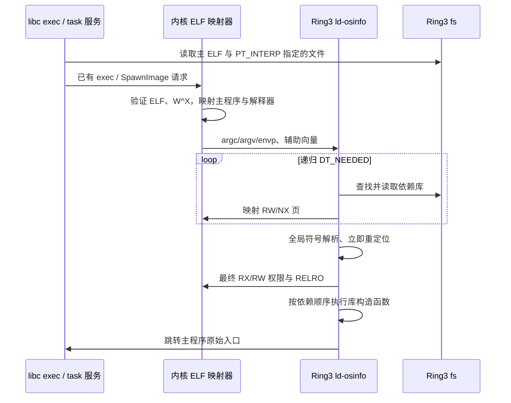

# ELF 解释器与用户态动态链接

普通磁盘应用使用 `PT_INTERP=/lib/ld-osinfo-x86-64.so`。解释器实现位于 `user/ld/`，是自包含的 Ring3 ELF64 程序，静态链接一份 OS 引导运行时，不依赖 libc 或共享库。操作复用现有 IPC、映射和句柄机制，未新增 syscall。

## 加载边界

内核不解析普通应用的库搜索路径或依赖集。`ExecImageInfo.sharedImages` 与 `SpawnImageInfo.sharedImages` 在此路径只承载解释器文件，数量为 1；静态程序为 0。内核仍检查文件大小、地址范围、段权限和入口。缺失解释器时 exec 在提交前失败。缺失依赖或未定义符号由解释器输出 `[LD]` 错误及名称，以退出码 127 结束新程序。

固定 boot ProgramId 在文件系统可用前启动，继续使用引导模块提供的四个运行时镜像及封闭内核链接路径。这只解决引导依赖，不对普通应用固定依赖，也不改变任何服务的 Ring3 身份。独立 guiw 包中的服务镜像使用此引导格式。

## 栈与辅助向量

初始栈为 `[argc][argv...][NULL][envp...][NULL][type,value...][AT_NULL,0]`，16 字节对齐。参数与环境各最多 64 项，每个字符串最多 383 字节。

| 项 | 含义 |
|---|---|
| AT_PHDR / AT_PHENT / AT_PHNUM | 不可写元数据页内的主程序头表、56 字节表项及数量 |
| AT_PAGESZ | 4096 |
| AT_BASE | 解释器映像地址 |
| AT_ENTRY | 主程序经过 bias 修正的入口 |
| AT_EXECFN | 内核复制的实际程序名称/路径，不依赖 argv[0] 的写法 |
| 0x60000001 | libc exec 运行时状态地址，0 表示没有 |
| 0x60000002 | 主程序 load bias；解释器读取后改写为下一项 |
| 0x60000003 | 共享库析构入口，由 OS Runtime 在主程序析构之后调用 |

元数据保留地址为 `0x20000`，exec 运行时状态为 `0x30000`，解释器链接地址为 `0x70000000000`。这些区域与用户堆、共享库和用户栈分离。解释器以原始栈跳转主程序 `_start`，libc 恢复文件描述符、工作目录和环境。

## 依赖与搜索

`DT_NEEDED` 按广度优先加载，最多 32 个映像，每个映像最多 32 个直接依赖。同名依赖去重，依赖环不会无限递归。全局符号查找先主程序，再按加载顺序查找库，允许弱未定义符号为 0。

搜索顺序为 `LD_LIBRARY_PATH`、请求映像的 `DT_RUNPATH`（没有时采用 `DT_RPATH`）、`/lib:/usr/lib:/usr/local/lib`。路径列表只接受绝对目录，忽略空项；RUNPATH 支持 `$ORIGIN` 与 `${ORIGIN}`。需要绝对路径的 `DT_NEEDED` 也可以直接使用。真实/有效 UID 或 GID 不同时忽略环境和运行路径搜索。未找到库明确报错，不自动塞入无关依赖。

## 重定位与初始化

支持 SYSV `DT_HASH`，x86-64 RELA 的 NONE、RELATIVE、64、GLOB_DAT、JUMP_SLOT；PLT 采用启动时立即绑定。映射阶段为 RW/NX，拒绝文本重定位和任何 RWX 页面，重定位之后恢复段权限并处理 GNU_RELRO。按依赖顺序执行 DT_INIT、DT_INIT_ARRAY，退出时逆序执行 DT_FINI_ARRAY、DT_FINI。

共享库构造前先准备 OS 堆、绑定 libc 环境并导入 exec 描述符和工作目录。主程序 `_start` 保留这些状态，避免再次清空构造函数分配的内存或覆盖其环境修改；exec 状态只导入一次。

当前不支持 TLS、IFUNC、COPY/PC32 重定位、GNU hash 单独使用、符号版本、RELR、惰性绑定和 dlopen。遇到相关格式会报告错误；SDK 使用 PIC 和 SYSV hash 生成受支持格式。这些范围不等同于 Linux 动态库二进制兼容。

`tests/linker/` 的运行测试覆盖无 GUI/C++ 依赖的自选库、传递依赖、`$ORIGIN`、共享库构造函数、缺库及未定义符号；`tests/desktop-runtime.cc` 检查实际 exec 返回状态。链接器的正常启动还覆盖 shell、login 和桌面客户端。
