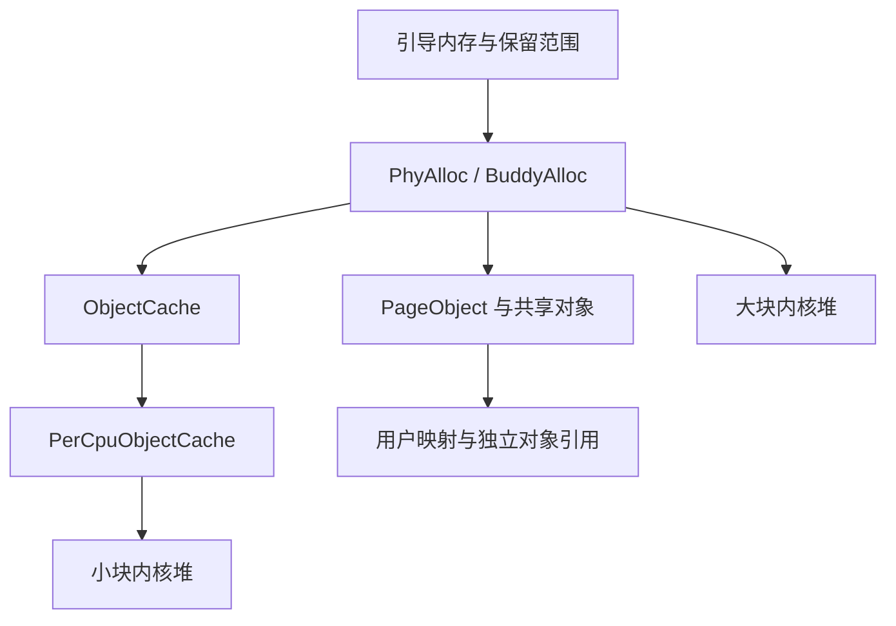

# 内核内存管理

实现位于 `src/kernel/memory/`，声明集中在 `include/kernel/mm.h`、`page.h`，命名空间为 `kernel::mm`。缺页异常入口 `handlePageFault` 位于 `kernel::cpu`，汇编内存原语保留 C 链接名。

内核维护物理页、对象引用和页表，用户态 MM 负责 VMA、文件后备、缺页与回收策略。`memory.kernel` 是在调用线程内执行的内核机制端点，不能与 Ring3 的 mm 进程混为一体。

## 源文件分工

| 文件 | 实现内容 |
| --- | --- |
| `physical/physical.cc` | PhyAlloc 的引导可用页筛选、元数据保留和物理分配入口。 |
| `physical/buddy.cc` | BuddyAlloc 的按阶分配、分裂、合并、引用计数及所有者检查。 |
| `physical/topology.cc` | MemoryTopology 从 ACPI SRAT 建立内存和 CPU 的 NUMA 归属。 |
| `heap.cc` | 内核堆大小分类、分配头、普通释放与缓存回收。 |
| `object/slab.cc` | ObjectCache 的页内对象槽、空闲链和空 slab 回收。 |
| `object/per_cpu.cc` | PerCpuObjectCache 的本 CPU 暂存和共享缓存退回。 |
| `object/pool.cc` | FixedPool 的固定容量槽位、空闲索引和重复释放检查。 |
| `object/mapping.cc` | 物理块的稳定堆别名、清零和别名地址换算。 |
| `object/page_object.cc` | PageObject 的页块分配、对象引用与物理引用配对。 |
| `virtual/virtual.cc` | 四级页表、地址翻译、跨地址空间复制、根创建、克隆和销毁。 |
| `virtual/page_mappings.cc` | Maps 的 PageObject 区间记录、引用、拆分和 COW 权限限制。 |
| `virtual/operations.cc` | 面向 Task 的匿名映射、解除映射和保护操作。 |
| `shared/shared.cc` | SharedMemory 的名称、打开包装、共享页和映射记录。 |
| `service/mapping.cc` | 映射请求授权、目标 Task 查找和不同后备类型分派。 |
| `service/pager.cc` | PagerBridge 绑定用户态 MM、转交缺页与同步 fork 状态。 |
| `service/service.cc` | 内存端点请求、页状态和统计查询、冻结恢复及页对象分配。 |
| `fault.cc` | 读取 CR2、尝试 Pager 恢复、转换用户信号或进入内核应急诊断。 |
| `memory.S` | 内核独立链接所需的 memset、memcpy 和 memmove。 |

## 分配层次和依赖

物理分配先于堆，因此引导元数据不能依赖尚未初始化的堆。CPU 本地状态建立后，才启用 NUMA 当前节点选择和每 CPU 对象缓存，早期分配使用回退节点和缓存槽。

`initPhy(boot)`、`initVir(boot)`、`initHeap()` 依次建立物理资源、采用引导页表和初始化堆。具体过程见 [物理内存](physical.md)、[虚拟内存](virtual.md) 和 [对象分配](object.md)。

## 地址、权限和所有权

普通页大小为 4096 字节。用户机制范围为 `[0x10000, 0x0000800000000000)`；直接映射基址为 `0xffff800000000000`，NX 堆别名基址为 `0xffff804000000000`。物理地址、内核别名和用户地址不是可互换的参数。

pagePresent、pageWritable、pageUser、pageWriteThrough、pageCacheDisable、pageGlobal、pageNoExecute 表示页表属性；pageExternal 是软件所有权标记，表示页表不独立拥有该叶子的物理页。删除 external PTE 后，底层页是否释放由页对象、共享对象或设备资源域决定。

用户映射机制拒绝同时可写和可执行。硬件页表中存在某个映射，并不自动授权另一个进程访问或重新映射它。

## 服务和缺页

映射、解除映射和权限修改通过 CallService 进入 memory.kernel，操作码为 Map、Unmap、Protect，没有对应的独立 syscall 8～10。取得服务端点只允许调用，跨进程操作仍要求当前 Memory 角色、Memory 能力和恢复域所有权。

用户态合法缺页经 PagerBridge 转成带真实发送者身份的 RPC。内核不在持目标地址空间锁时等待用户 Pager；回复成功后还要重新检查实际 PTE。具体函数、请求和期限见 [内存机制服务](service.md)。

## 并发与回收关系

目标地址空间锁稳定页表根和代数；全局页表锁串行化实际表项访问；映射注册表和物理分配器各有自己的锁。映射路径按地址空间、注册表、低层页表的关系进入，不能持地址空间锁等待需要向该目标映射页面的 Pager。

解除映射先确认范围并准备可能需要的拆分记录，再撤销 PTE、完成必要的 TLB 失效，最后提交记录更新并释放相应引用。进程退出或 exec 还必须先等待远端 CPU 离开旧地址空间；设备 DMA 停止是另一项前提，不能由 CPU 停稳替代。

本目录实现当前的有界机制，不据此承诺完整 mmap、文件写回、换页或任意硬件内存管理。用户态 MM 的策略说明位于 [MM 服务](../../service/mm.md)。
